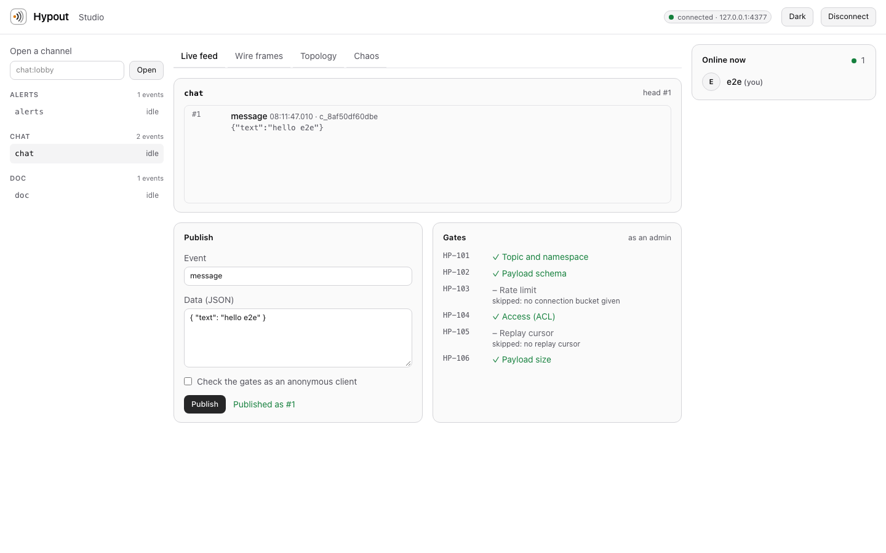

<div align="center">


# Hypout

**Self-hosted real-time infrastructure you can audit: WebSockets, pub/sub, live presence and replay in one process.**

The RFC 6455 handshake, framing and masking are implemented here from the specification. No `ws`. No `socket.io`. No third-party networking code on the hot path.

[](https://github.com/isagarpinninti/hypout/actions/workflows/ci.yml)
[](https://www.npmjs.com/package/@hypout/cli)
[](https://www.npmjs.com/package/@hypout/core)
[](https://www.npmjs.com/package/@hypout/react)
[](package.json)
[](LICENSE)

[Quickstart](#quickstart) · [Guide](docs/GUIDE.md) · [Documentation](#documentation) · [Security](#security) · [Limits](#limits-read-before-adopting)

</div>

```bash
npx @hypout/cli init && npx @hypout/cli studio
```

<p align="center">
  
</p>

## Contents

- [Overview](#overview)
- [Capabilities](#capabilities)
- [How it compares](#how-it-compares)
- [Quickstart](#quickstart)
- [Using Hypout](#using-hypout)
- [Architecture](#architecture)
- [Security](#security)
- [Quality and verification](#quality-and-verification)
- [Performance](#performance)
- [Limits: read before adopting](#limits-read-before-adopting)
- [Documentation](#documentation)
- [Development](#development)
- [Support, contributing, license](#support-contributing-license)

## Overview

Live features (chat, notifications, collaborative cursors, dashboards) usually mean a hosted service you cannot inspect, or a large library whose protocol you take on faith. Hypout is a small, self-hosted server whose every moving part can be read, run in a test, and watched on the wire. You run one process, define your channels in JSON, mint scoped tokens in your backend, and connect browsers with a React client or plain WebSocket.

**Good fit:** internal tools, SaaS features with modest fan-out, products that must keep data on their own infrastructure, teams that want to understand and test their real-time layer, learning and teaching how WebSocket works.

**Not (yet) a fit:** multi-node clusters, durable message history, millions of concurrent connections. See [Limits](#limits-read-before-adopting).

## Capabilities

| | |
| --- | --- |
| **Standards-faithful WebSocket** | Handshake, frame parser, masking, fragmentation, control frames, close codes and UTF-8 validation per RFC 6455, tested against the RFC's examples, property tests and real sockets (including Node's built-in `WebSocket`). Violations get the correct close code (`1002`, `1003`, `1007`, `1009`). |
| **Pub/sub channels** | Namespaced channels (`chat:room-42`) defined in JSON: access rules, event names, payload schemas, rate limits and retention per namespace. |
| **Six gates** | Every operation passes `HP-101` to `HP-106` (topic, schema, rate, access, replay cursor, size). Refusals name the gate and reason; nothing is dropped silently. |
| **Replay** | Bounded per-channel ring buffers. Clients resume from "everything after #N" after a reconnect or a detected gap. |
| **CRDT presence** | A roster built from last-writer-wins registers and Lamport clocks: operations commute, so clients converge regardless of order, duplication or replay. |
| **Scoped tokens** | HMAC-SHA256 capability tokens (`chat:*=sub,pub`), minted in your backend, verified in constant time, with expiry. |
| **Studio** | A web console: channel list, live feed, gate pre-flight, wire-frame inspector (decodes headers in the browser), topology view and a chaos panel. WCAG 2.1 AA checked with axe in light and dark themes. |
| **Chaos engineering built in** | Drop or delay a share of frames, or cut every socket, and watch clients recover. |
| **Audit ledger** | Hash-chained log of every published event; `hypout ledger verify` finds edits, removals and reordering. |
| **REST API** | Publish, read channels, members and recent events, run the gates, mint tokens, read stats. |

## How it compares

An honest, short comparison; it is not a claim that Hypout is better for every job.

| | Hypout | `ws` / a hand-rolled server | Socket.IO | Hosted (Pusher, Ably, …) |
| --- | --- | --- | --- | --- |
| Hosting | Your process | Your process | Your process | Their cloud |
| Channels, presence, replay | Built in | You build them | Rooms; presence and replay are on you | Built in |
| Wire format | Plain WebSocket and JSON | Plain WebSocket | Socket.IO protocol (needs its client) | Vendor SDK |
| Auditable by reading | Small codebase | n/a | Large | Closed |
| Horizontal scale | Not yet | You build it | Adapters (Redis, …) | Managed |
| Durable history | No (bounded, in memory) | You build it | You build it | Often |
| Operational burden | You run it | You run it | You run it | None |

## Quickstart

**Requirements:** Node.js 20 or newer (the browser client needs a browser, or Node 22+ for its global `WebSocket`).

```bash
mkdir realtime && cd realtime
npx @hypout/cli init        # hypout.config.json + channels/chat.json, alerts.json, doc.json
npx @hypout/cli validate    # check config and channel definitions
npx @hypout/cli studio      # serve on 127.0.0.1:4320 and print the Studio link
```

Open the printed link, pick `chat`, press **Publish**. From a second terminal:

```bash
npx @hypout/cli publish alerts notice '{"level":"info","message":"deploy finished"}'
npx @hypout/cli token mint --sub ada --caps "chat:*=sub,pub,presence" --ttl 900
```

The complete walkthrough, including tokens, React, backend publishing, chaos tests, deployment behind TLS and troubleshooting, is in **[docs/GUIDE.md](docs/GUIDE.md)**.

## Using Hypout

### In React

```bash
npm install @hypout/react zod
```

```tsx
import "@hypout/react/styles.css";
import { HypoutProvider, LivePresenceRoster, useChannel } from "@hypout/react";

export function Room({ token }: { token: string }) {
  return (
    <HypoutProvider options={{ url: "wss://realtime.example.com/ws", token }}>
      <Chat />
      <LivePresenceRoster channel="chat:lobby" state={{ name: "Ada" }} />
    </HypoutProvider>
  );
}

function Chat() {
  const { events, publish, subscribed } = useChannel("chat:lobby", { event: "message" });
  return (
    <>
      <ul>{events.map((e) => <li key={e.seq}>{JSON.stringify(e.data)}</li>)}</ul>
      <button disabled={!subscribed} onClick={() => publish("message", { text: "hello" })}>Send</button>
    </>
  );
}
```

### Without React

```ts
import { HypoutClient } from "@hypout/react";   // framework-free

const client = new HypoutClient({ url: "ws://localhost:4320/ws", token });
client.subscribe("alerts", { onEvent: (e) => console.log(e.seq, e.data) });
await client.publish("chat:lobby", "message", { text: "hi" });
```

Any other language can speak the [wire protocol](docs/PROTOCOL.md) directly: JSON text frames over a WebSocket with the subprotocol `hypout.v1`.

### From your backend

```bash
curl -X POST http://127.0.0.1:4320/api/publish \
  -H "authorization: Bearer $HYPOUT_ADMIN_TOKEN" -H "content-type: application/json" \
  -d '{"channel":"alerts","event":"notice","data":{"level":"info","message":"hello"}}'
```

### Packages and commands

| Package | Role |
| --- | --- |
| [`@hypout/core`](packages/core) | The engine: codec, handshake, ring buffer, CRDT presence, tokens, gates and a transport-agnostic broker. `@hypout/core/protocol` is a browser-safe subset with no `node:*` imports. |
| [`@hypout/react`](packages/react) | Reconnecting client, hooks, and the components `LivePresenceRoster`, `ChannelTopologyStudio`, `WireFrameInspector`, `ChaosDropSimulator`. |
| [`@hypout/cli`](packages/cli) | The `hypout` command: server, REST API, ledger and bundled Studio. |

| Command | Purpose |
| --- | --- |
| `hypout init [dir]` | Scaffold `hypout.config.json` and example channels |
| `hypout validate` | Validate config and channels; warns about open publishing and undeclared events |
| `hypout studio` (`start`) | Run the server and print the Studio link; `--port`, `--host`, `--no-studio`, `--no-ledger`, `--quiet` |
| `hypout publish <channel> <event> [json]` | Publish through a running server |
| `hypout token mint --sub <id> [--caps …] [--ttl s] [--admin]` | Mint a signed token |
| `hypout ledger verify` | Verify the audit ledger's hash chain |
| `hypout inspect <hex>` | Explain a WebSocket frame header |

Exit codes: `0` success, `1` a check failed, `2` bad usage.

## Architecture

```mermaid
flowchart LR
  B1[Browser / app] -- ws --> S
  B2[Browser / app] -- ws --> S
  P[hypout publish / REST] -- http --> S
  subgraph S[@hypout/cli process]
    H[HTTP + upgrade handler] --> D[Frame decoder]
    D --> BR[Broker - @hypout/core]
    BR --> G[Gates HP-101..106]
    BR --> R[Ring buffers]
    BR --> C[CRDT presence]
    BR --> L[Ledger]
    BR --> E[Encode once, write to each socket]
  end
```

The broker is synchronous and never touches a socket, so every behaviour is tested without I/O and runs identically under any transport. Everything that can grow with traffic is bounded. Details: [docs/ARCHITECTURE.md](docs/ARCHITECTURE.md).

## Security

- Binds to `127.0.0.1` by default; warns when bound elsewhere.
- Scoped, expiring, HMAC-signed tokens; admin REST API behind a bearer token; no cookies, so no CSRF surface.
- The Studio's admin token travels in the URL **fragment** and never reaches a server.
- Limits on frame size, message size, subscriptions, channels, connections, presence members, queued bytes per peer and request bodies; idle channels are swept; peers that stop answering Pings are closed.
- No telemetry and no outbound connections.

You are responsible for TLS (use a reverse proxy), restricting `allowedOrigins`, keeping tokens short-lived and keeping query strings out of proxy logs. The [security model](docs/SECURITY_MODEL.md) spells out what is and is not defended, including what the ledger does not prove. Report vulnerabilities privately: [SECURITY.md](SECURITY.md).

## Quality and verification

Everything below runs in CI on every push and before every release.

| Check | Scope |
| --- | --- |
| Unit and property tests | `@hypout/core` (also under Zod 3 and 4), `@hypout/react`, `@hypout/cli`: codec against RFC examples and fast-check properties, broker without sockets, CRDT convergence, real-socket interop |
| End-to-end | Playwright drives the real server and Studio: publish, presence, chaos and replay, reconnect, keyboard navigation, no sideways scroll at 375 px |
| Accessibility | axe (WCAG 2.0/2.1 A and AA) on every Studio view, light and dark; no serious or critical violations allowed |
| Smoke test | Packs the three packages, installs them into a clean project, and drives the installed CLI over a real WebSocket |
| Static checks | `tsc --noEmit` in strict mode with `noUncheckedIndexedAccess`; ESLint with `no-explicit-any` and `no-eval` as errors |
| Node versions | 20, 22 and 24 |
| Provenance | Packages are published from CI with npm provenance |

## Performance

`npm run bench` runs a fan-out benchmark over real sockets and a codec micro-benchmark. On a developer laptop (Node 24) with 100 subscribers receiving 2,000 messages from one publisher, in the same process as the server, it delivered 200,000 messages in about 1 second (roughly 200k deliveries/s, p99 latency under 30 ms). Treat this as an order-of-magnitude indication, not a capacity guarantee: your hardware, payload sizes, network and client mix will differ, and the clients in the benchmark share the server's CPU. CI enforces a generous budget to catch regressions of around 10x.

## Limits: read before adopting

- **Single process, in memory.** Channels, retained events and presence live in RAM. A restart clears them and clients carry on from "now". There is no clustering, and no durable history (the ledger stores hashes, not payloads).
- **Text frames only.** JSON up to `maxPayload` (64 KiB by default). Binary frames are refused with `1003`.
- **No `permessage-deflate`.** Frames with RSV1 set are a protocol error.
- **TLS is yours.** The server speaks plain HTTP and `ws://`; terminate TLS in a reverse proxy.
- **Token in the query string.** Browsers cannot set headers on a WebSocket, so the client sends `?token=`. Use short-lived tokens and keep query strings out of logs, or use the `auth` message.
- **Tokens cannot be revoked individually.** Keep lifetimes short; rotating `HYPOUT_SECRET` invalidates all of them.
- **The ledger is tamper-evident, not tamper-proof.** Someone who can rewrite the whole file can rebuild the chain; anchor the head hash elsewhere if that matters.
- **Pre-1.0.** The API may change between minor versions; changes are recorded in the [changelog](CHANGELOG.md).

## Documentation

| | |
| --- | --- |
| [Guide](docs/GUIDE.md) | Step-by-step: project, tokens, React, backend publishing, chaos testing, deployment, audit, troubleshooting |
| [Configuration](docs/CONFIGURATION.md) | Config keys, channel definitions, schemas, tokens, REST API, ledger |
| [Wire protocol](docs/PROTOCOL.md) | Messages, close codes, gates, replay and presence semantics |
| [Architecture](docs/ARCHITECTURE.md) | Packages, message path, design decisions |
| [React](docs/REACT.md) | Client, hooks, components, SSR |
| [Security model](docs/SECURITY_MODEL.md) | Threat model and operator responsibilities |

## Development

```bash
git clone https://github.com/isagarpinninti/hypout.git && cd hypout
npm install
npm run build        # core, react, Studio (static export), then CLI
npm test             # core (also Zod 3), react, cli
npm run e2e          # Playwright + axe (run `npx playwright install chromium` once)
npm run smoke        # pack, install in a clean project, drive the CLI
npm run bench        # fan-out and codec benchmark
npm run gates        # everything above, in order
```

Repository layout: `packages/core`, `packages/cli`, `packages/react`, `src/` (the Studio), `e2e/`, `scripts/`, `docs/`, `examples/basic`.

## Support, contributing, license

- Questions and bugs: see [SUPPORT.md](SUPPORT.md). Security: [SECURITY.md](SECURITY.md).
- Contributions are welcome: [CONTRIBUTING.md](CONTRIBUTING.md) and the [code of conduct](CODE_OF_CONDUCT.md).
- Release history: [CHANGELOG.md](CHANGELOG.md).
- [MIT](LICENSE) © Sagar Pinninti
